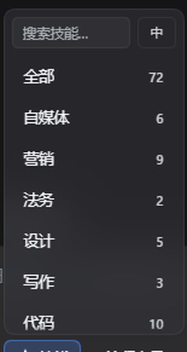
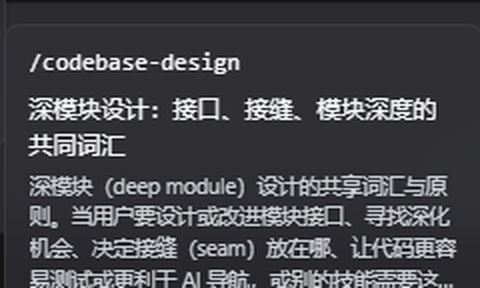

# 技能抽屉 · Skill Drawer

在 DeepSeek Harness（DSH）的输入框旁边加一个「技能」按钮，点开是一个贴着按钮的抽屉：
按分类浏览本机技能，搜中文或英文，点一下把 `/技能名 ` 插进输入框。

> **只读**：不修改任何 `SKILL.md`，不写技能目录，不向任何地方上传数据。

<sub>English summary: a read-only skill browser for the DSH composer. It lists the skills your
session already has (user-level and project-level), groups them into categories, lets you search
by name or description, and inserts `/name ` at the caret. No build step, MIT licensed.</sub>



## 能做什么

- **按会话读取技能**：走官方 `remote.skills.list({ sessionId })`，用户级（`~/.dsh/skills`）与当前项目的 `.dsh/skills` 自动出现，换会话、换项目自动跟着变；一个技能都没有时显示空状态，不报错
- **自动分类**：自媒体 / 营销 / 法务 / 设计 / 写作 / 代码 / 办公 / 视频 / 流程 / 其他，按技能名与描述里的关键词归类
- **搜索**：技能名、中文说明、英文描述都能搜
- **中 / EN 切换**：搜索框右侧切换界面与说明语言；技能名始终是英文命令，不翻译
- **说明卡片**：鼠标停在技能上，右侧弹出说明——中文一句话 + 英文原文小字 + 来源（用户级 / 项目级 / 内置）
- **点一下就插入**：把 `/名字 ` 插到光标处，菜单关闭；草稿被改动过时不会静默失败，会提示重试
- **键盘可用**：`↑ ↓` 移动、`→` 展开、`←` 收起、`Enter` 插入、`Esc` 关闭
- **流程步骤标记**：成链使用的技能显示 `(2/5)`，卡片里注明属于哪条流程



## 安装

### 方式一：设置里安装（推荐）

DSH → 设置 → 插件 → 安装，选择下面任一形式：

- 本地目录：指向本仓库目录
- GitHub：发布后填 `github:<账号>/dsh-skill-drawer`

### 方式二：命令行

```powershell
dsh plugin add github:<账号>/dsh-skill-drawer
```

装完**完全退出 DSH（含托盘）再启动**，然后刷新页面（Ctrl+R），输入框左侧会出现「技能」按钮。

## 卸载

设置 → 插件 → 卸载，或删掉 profile 里 `dsh-skill-drawer` 那一行。技能文件不受影响。

## 行为说明

- **默认隐藏 `speckit-*`**：这些技能由「流程向导」负责安装与执行，直接插入命令在未安装的工作流里跑不起来，列在抽屉里只会误导。想全部显示，把 `client.js` 里 `PERSONAL.hiddenPrefixes` 改成 `[]`
- **中文说明来自本机文件**：仓库里**不含任何翻译**。插件在打开时向本机接口要
  `~/.dsh/skill-drawer/notes-zh.json`（`{ "技能名": "一句中文" }`），有就显示中文，
  没有就显示技能自带的英文描述。纯本地、不联网、不花 Token
- **不写文件、不联网、不读技能正文**：只读技能名/描述/来源这些元数据

## 本地中文说明

仓库不带翻译。想给技能加一句中文，在本机建这个文件即可（不会进 Git）：

```text
%USERPROFILE%\.dsh\skill-drawer\notes-zh.json
```

```json
{
  "diagram-design": "画架构图/流程图/时序图，可导出 PNG/SVG",
  "office-xlsx": "读写 Excel，公式与校验"
}
```

- 键是技能名（不带 `/`），值是一句中文
- 文件不存在 / 格式坏了 → 全部回退英文原文，不报错
- 读取由宿主端一个小接口完成（`/dsh-skill-drawer/api/notes`），只读、只读这一个文件

## 个人定制

`client.js` 顶部有一块 `PERSONAL` 区块，升级时只改这一段就能保留你的习惯：

```js
const PERSONAL = {
  hiddenPrefixes: ['speckit-'], // 不想显示某类技能就加前缀
  showChainStep: true,          // 列表里是否显示 (2/5) 步骤标记
  showOriginalUnderChinese: true, // 中文模式下是否附加英文原文小字
}
```

## 开发

没有构建步骤：`client.js` 就是浏览器实际加载的源文件。

```powershell
node --check index.js
node --check client.js
node scripts/smoke.mjs      # 8 项自检：加载握手、注入声明、槽位注册、失败兜底
```

自检里有一条硬检查：源码里每个 `ctx.<service>` 都必须出现在 `inject` 里。缺了会直接让宿主崩溃
（Cordis 在代理层抛错，`try/catch` 兜不住），所以宁可让测试失败，也不让进程挂掉。

更多约定见 [`AGENTS.md`](AGENTS.md) 与 [`docs/rules.md`](docs/rules.md)。

## 目录

```
client.js            浏览器端全部逻辑（无构建）
index.js             宿主端：故意空转，不注入服务、不注册路由
cordis.patch.yml     插件装载声明
locale/              插件元数据的中英文文案
scripts/smoke.mjs    离线自检
docs/                截图与开发规则
```

## License

[MIT](LICENSE)
